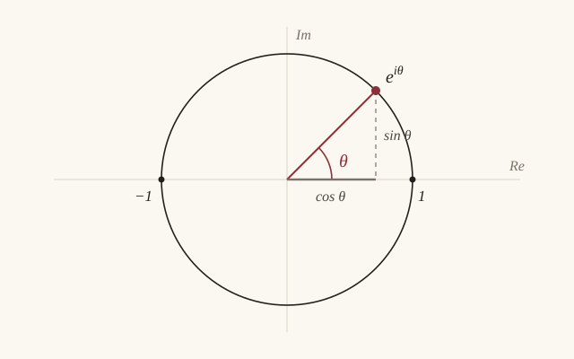

draft: true なので公開されません（npm run dev のときだけ表示されます）。

## 数式

文中は $e^{i\theta} = \cos\theta + i\sin\theta$ のように `$...$` で書く。

独立した行は `$$...$$`：

$$
e^{i\pi} + 1 = 0
$$

複数行：

$$
\begin{aligned}
\cos x &= 1 - \frac{x^2}{2!} + \frac{x^4}{4!} - \cdots \\
\sin x &= x - \frac{x^3}{3!} + \frac{x^5}{5!} - \cdots
\end{aligned}
$$

## 画像

記事と同じフォルダに置いて `./` で参照する。`"..."` の部分がキャプションになる。



## コード

```python
import cmath
print(abs(cmath.exp(1j * cmath.pi) + 1))
```

## 表

| $\theta$ | $\cos\theta$ | $\sin\theta$ |
| --- | --- | --- |
| $0$ | $1$ | $0$ |
| $\pi/2$ | $0$ | $1$ |
| $\pi$ | $-1$ | $0$ |

## 引用と脚注

> 引用はこう書く。

脚注はこう書く[^1]。

[^1]: 脚注の本文。
