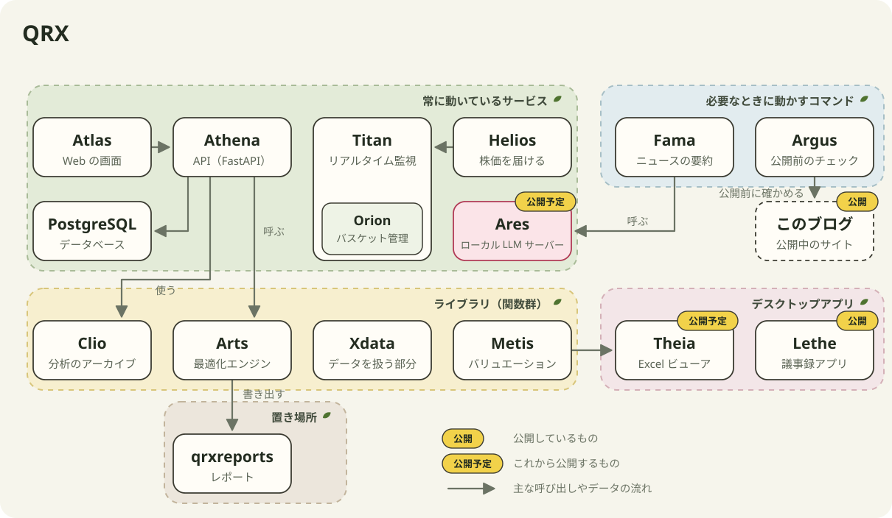

いま作っているツールは、まとめて QRX と呼んでいます。この記事では、QRX の中身を、公開しているものと公開していないものに分けて整理しておきます。名前の多くはギリシャ・ローマ神話から取っています。

（TODO：非公開のツールの名前や役割を、どこまで公開してよいか）

## 全体像

QRX の中心は qrxarts というリポジトリです。主に Python で書いていますが、バックテストは Rust で書いています。qrxarts は、サービス群、Arts、バックテスト、Xdata に分かれています。

## 公開しているもの

| 名前 | 何をするか |
| --- | --- |
| [Lethe](https://github.com/Hitoshi-Nakanishi/lethe-app) | 会議や通話を Whisper で文字起こしして、議事録にするデスクトップアプリ |

Lethe も QRX の一部ですが、qrxarts とはつながっていません。LLM は Ollama を直接使っています。

QRX とは別に、このブログも公開しています。

（TODO：これから公開する予定のもの）

## 公開していないもの

### qrxarts のサービス群

| 名前 | 何をするか |
| --- | --- |
| Atlas | Web の画面 |
| Athena | Atlas や Jupyter から呼ぶ API |
| Titan | 市場をリアルタイムで監視する |
| Orion | Titan の中にある、もうひとつの監視画面 |
| Helios | Titan に株価を届ける |
| Clio | 分析内容のアーカイブ |
| Fama | ニュースを要約する |
| PostgreSQL | 共通のデータベース |

Atlas は Athena の API を呼んで画面を作ります。Titan は Helios から株価を受け取ります。Titan と Orion の内容は、Atlas の画面からも見られます。

### エンジンとライブラリ

| 名前 | 何をするか |
| --- | --- |
| Arts | 関数型で書いた最適化エンジン |
| バックテスト | Rust で書いている |
| Xdata | データを扱う部分 |
| Metis | バリュエーション用の Excel ワークブックを作る |

### qrxarts の外にあるもの

| 名前 | 何をするか |
| --- | --- |
| qrxreports | レポートの置き場所 |
| Ares | ローカル LLM の推論サーバーの起動と停止を管理する |
| Theia | Metis が作ったワークブックを、Excel を開かずにすばやく見るデスクトップアプリ |

レポートは LaTeX と PDF で、qrxarts が書き出したものを qrxreports に置き、Athena が画面に出します。Theia は PySide6 で作っています。

## LLM まわり

ニュースの要約やレポートの作成、埋め込みには、手元の GPU で動かしているローカル LLM を使っています。推論エンジンは Strata、vLLM、Ollama のどれかで、起動と停止は Ares で管理しています。

どのエンジンも OpenAI 互換の API で呼べるので、qrxarts 側のコードはエンジンが変わっても同じです。
